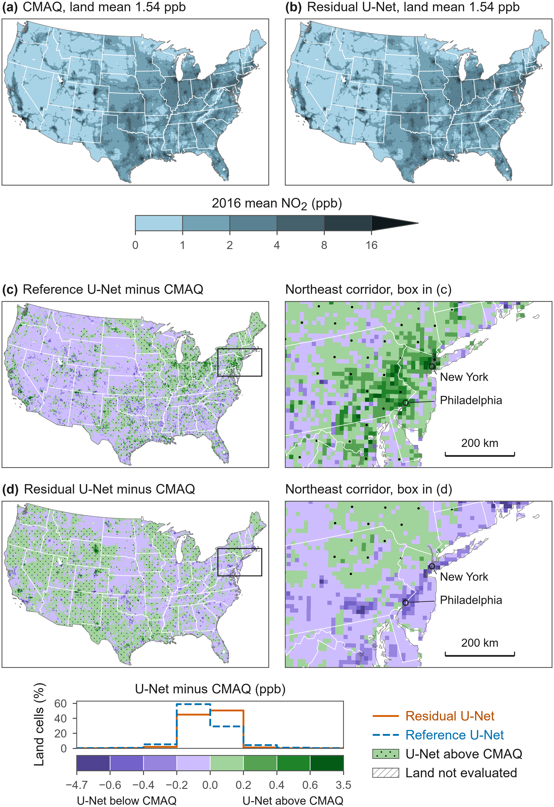

# Deep-learning emulators of CMAQ daily mean surface NO<sub>2</sub> over the contiguous United States, 2015 to 2019

<p>
<strong>Ehsan Nikfarjam</strong>, Independent Researcher, <a href="https://orcid.org/0009-0002-7423-2819" aria-label="View ORCID record - 0009-0002-7423-2819"> https://orcid.org/0009-0002-7423-2819</a>, GitHub <a href="https://github.com/ehsannikfarjam">@ehsannikfarjam</a><br>
<strong>Mohsen Nikfarjam</strong>, Independent Researcher, <a href="https://orcid.org/0009-0003-8753-3773" aria-label="View ORCID record - 0009-0003-8753-3773"> https://orcid.org/0009-0003-8753-3773</a>, GitHub <a href="https://github.com/mohsennikfarjam">@mohsennikfarjam</a><br>
These authors contributed equally; their roles are listed under <a href="#attribution">Attribution</a>.
</p>

This repository accompanies a report dated 2 November 2026, which has not yet been peer reviewed and is not yet public. The abstract, the background, the data description and the limitations below quote the report word for word, with its numbering of sections, figures and appendices, and the results in this repository are those of the report.

## Abstract of the report

Chemical transport models such as the Community Multiscale Air Quality model (CMAQ) are costly; a fast emulator could let many more cases be examined. This report describes two deep-learning emulators of CMAQ's daily mean surface nitrogen dioxide (NO<sub>2</sub>) on 53,594 land cells of the contiguous United States at 12 km, trained on the U.S. Environmental Protection Agency's EQUATES v1.0 data for 2015 to 2019.

Each year was held out in turn; 112 days were held back beforehand. On the 1,687 test days, the main emulator, a residual U-Net predicting CMAQ's departure from its weekday climatology (training-year average by date and weekday), had a root mean square error (RMSE) of 0.501 parts per billion (ppb) and a correlation of 0.956 with CMAQ (means of five yearly values). Four comparisons fixed in advance favored it after adjustment for multiple testing. Its skill score against the climatology was 0.763 (98.75 percent interval over resampled days, 0.752 to 0.771). Its RMSE was 0.100 ppb below that of gradient-boosted trees and 0.074 ppb below that of the other emulator, a reference U-Net built like a published one, trained for fewer steps. Each comparison again favored it in 2019, with training on earlier years only, and on the held-back days.

Both emulators underestimated CMAQ's highest tenth of values on average in every year, partly because that tenth was set by CMAQ's own values. These results measure agreement with CMAQ in held-out years; agreement with observations, the response to changed emissions and speed against CMAQ remain untested.

The walkthrough notebook, [CMAQ_NO2_Emulator_Walkthrough.ipynb](CMAQ_NO2_Emulator_Walkthrough.ipynb), presents the study with the report's main figures redrawn from the deposited outputs; [Contents](#contents) lists the folders and [Reproducing](#reproducing) gives the commands.



*Figure 2 of the report. Modeled mean surface NO<sub>2</sub> (ppb) over the 339 test days of 2016, CMAQ and two emulators, contiguous US land cells of the 12 km grid, 2016 held out. (a) CMAQ and (b) the residual U-Net in six blue classes of doubling width (breaks 1 to 16 ppb). (c) The reference and (d) the residual U-Net minus CMAQ in steps of 0.2 ppb, purple below CMAQ and green above; outer classes run beyond &plusmn;0.6 ppb. Insets enlarge the boxed Northeast corridor; open circles mark cities. The lines over the color bar give each class's share of land cells. Dots mark the cells above CMAQ, the rarer sign over the figure's difference maps. Hatching marks the 85 cells of US land not evaluated, and white marks water and land outside the US; white lines are state boundaries and the gray line the coast and national borders. The maps use an equal-area projection.*

## Background and design

For nitrogen dioxide (NO<sub>2</sub>) only, the analyses behind Figures 3 to 5 of Payami et al. (2025) were repeated on the Air QUAlity TimE Series (EQUATES) data of the U.S. Environmental Protection Agency (EPA) for 2015 to 2019. Payami et al. (2025) trained U-Nets (Ronneberger et al., 2015) on EQUATES to emulate the daily mean surface NO<sub>2</sub>, ozone and fine particulate matter of the Community Multiscale Air Quality model (CMAQ) over the contiguous United States (US), holding out one year at a time. They plotted emulated against simulated values (their Figure 3), the mean maps of 2016 (their Figure 4) and the daily series of 10 large cities (their Figure 5). An earlier U-Net emulator of CMAQ's hourly surface NO<sub>2</sub> over the contiguous US (Salman et al., 2024) simulated one hour in 10.5 s on one processor, against 71.75 min for CMAQ, also on one processor (their p. 10).

This report follows the design of Payami et al. (2025) and extends it with simpler models, comparisons specified in advance, held-back weeks and repeated trainings. Two emulators were trained on the same data and tested on the same held-out years and test days: a reference U-Net built like the published one, and a residual U-Net that predicts CMAQ's departure from a climatology of CMAQ fitted on the training years. Both were compared with simpler models (climatologies, regressions, gradient-boosted trees and a per-cell network), so that the gain from deep learning could be judged against what simpler tools already achieve. Four comparisons each had a margin, the smallest difference worth reporting (Section 3.3). A set of whole weeks was held back from training and evaluated once at the end, and the trainings with 2016 and with 2019 held out were repeated from several random starts to measure training randomness.

The data and the land cells of the grid are described in Section 2, and the emulators, the simpler models, the training and the evaluation in Section 3. Section 4 reports the results, from the daily agreement with CMAQ to the errors at the highest values and on cell-days with emissions outside the training range. Section 5 discusses them beside the values published by Payami et al. (2025), and Sections 6 and 7 give the limitations and the proposed next steps. The appendices hold the data versions, splits, settings and compute (A to D), further tables and figures (E and F), the exploratory comparisons (G) and the analyses fixed in advance (H).

## Data

All inputs and the target came from EPA's EQUATES v1.0 data (U.S. EPA, 2021): CMAQ version 5.3.2 (U.S. EPA, 2020) simulations over the contiguous United States on EPA's 12 km grid (12US1), with the meteorology, made with the Weather Research and Forecasting model version 4.1.1 (Skamarock et al., 2019), and the emissions that CMAQ read (described for 2002 to 2017 by Foley et al., 2023). The data came from EPA's EQUATES pages and the Data Warehouse of the Community Modeling and Analysis System (CMAS), through three public routes (Appendix Table A1). EPA's Remote Sensing Information Gateway (RSIG) web service supplied CMAQ's hourly surface NO<sub>2</sub> and the surface and lowest-layer meteorological fields, aggregated on the server to daily means of the UTC day, and the boundary-layer height also to its daily maximum, for 2015 to 2019 and the last day of 2014, which the previous-day inputs need. EPA's local-day product of 2016 served as a check: on one summer day, 1 July 2016, over the grid's 137,241 cells, the mean absolute difference between EPA's local-day mean of surface NO<sub>2</sub> and the UTC-day mean was 0.098 parts per billion (ppb), and the mean difference, local-day minus UTC-day, was &minus;0.011 ppb. The public CMAS bucket on Amazon Web Services supplied the CMAQ-ready emissions of 2017 and 2019, their point-source stack files and 14 files of the Meteorology-Chemistry Interface Processor (MCIP) that describe the grid and the land surface. The emissions of 2015, 2016 and 2018 are published only on the CMAS Google Drive, from which they were taken.

The 12US1 grid has 299 rows and 459 columns of 12 km cells on a Lambert conformal projection; the maps draw each cell as its own quadrilateral in an equal-area projection (EPSG:5070). The emulators were trained and evaluated on its 53,594 land cells: the cells whose center lies inside the 48 contiguous states and the District of Columbia (Natural Earth's state boundaries at 1:10 million (admin-1) with large lakes removed, version 5.1.1) and that MCIP marks as land. Each city's point came from Natural Earth's populated places (version 5.1.2), and its series is the mean over the land cells of the 3 &times; 3 window of cells centered on the cell that holds the point (4 to 9 land cells).

| Input | Provider | Citation |
|---|---|---|
| CMAQ v5.3.2 hourly surface NO<sub>2</sub>, meteorology and grid files (EQUATES v1.0), 2015 to 2019 | U.S. EPA, through its Remote Sensing Information Gateway and the CMAS Data Warehouse | U.S. EPA (2021) |
| EQUATES CMAQ-ready emissions | CMAS Data Warehouse (Amazon Web Services and Google Drive) | Foley et al. (2023) |
| Natural Earth 1:10m admin-1 states, lakes removed (v5.1.1), and populated places (v5.1.2) | Natural Earth | Made with Natural Earth |
| 2010 TIGER/Line state boundaries | IPUMS NHGIS v19.0 | Manson et al. (2024) |

The EQUATES data are public and in the public domain (U.S. EPA, 2021); EPA's data use policy requires that a copy of the policy accompany any copy of the data passed on. The policy is in [results/EQUATES_Data_Use_Policy.pdf](results/EQUATES_Data_Use_Policy.pdf); it asks that published material cite the datasets (DOI 10.15139/S3/F2KJSK) and the emissions data (Foley et al., 2023); they are cited here as follows.

- U.S. Environmental Protection Agency (U.S. EPA) (2021). EQUATES CMAQv5.3.2 output (version 1.0) [data file and documentation]. <https://doi.org/10.15139/S3/F2KJSK>. Accessed 24 October 2026 through EPA's Remote Sensing Information Gateway and the CMAS Data Warehouse (Amazon Web Services and Google Drive).
- Foley, K. M., Pouliot, G. A., Eyth, A., Aldridge, M. F., Allen, C., Appel, K. W., Bash, J. O., Beardsley, M., Beidler, J., Choi, D., Farkas, C., Gilliam, R. C., Godfrey, J., Henderson, B. H., Hogrefe, C., Koplitz, S. N., Mason, R., Mathur, R., Misenis, C., Possiel, N., Pye, H. O. T., Reynolds, L., Roark, M., Roberts, S., Schwede, D. B., Seltzer, K. M., Sonntag, D., Talgo, K., Toro, C., Vukovich, J., Xing, J., Adams, E. (2023). 2002&ndash;2017 anthropogenic emissions data for air quality modeling over the United States. *Data in Brief* 47, 109022. <https://doi.org/10.1016/j.dib.2023.109022>

No input data are redistributed here. The NHGIS state boundaries are used under the IPUMS terms with their citation and are not included (see Reproducing).

The processed arrays that the networks were trained and evaluated on (24.75 GB) were made from the public EQUATES files by the pipeline's code (`pipeline/4_arrays/` and `pipeline/5_fills_and_statistics/`). They are not in this repository and are available on request, with EPA's data use policy. The code, the model weights and the arrays will be archived with a DOI when the study is submitted for publication.

## Model weights

The weights of the main models, the `best.pt` files of the residual and the reference U-Net for each of the five held-out years (ten files, about 0.43 GB), are attached to release v1.0.0 of this repository as assets; they are not part of the Git history. Each file is named for its model and held-out year (fold), for example `unet_residual_fold2015_best.pt`, and the release notes list every file with its model, its fold and its MD5 and SHA-256 checksums. The weights are released under CC BY 4.0 (see Licenses).

Each file is the dictionary that the training code saved with `torch.save` whenever the validation loss improved (`train` in `train/loop.py`, in `pipeline/6_shared/` for the reference U-Net and in `pipeline/7_train_residual/` for the residual U-Net). Its key `model` holds the network's `state_dict`; `training`, `step` and `val_loss` give the training's name and the step and validation loss at which the weights were kept.

The pipeline reloads a file with `fresh_model_from_best` in `pipeline/7_train_residual/train/loop.py`, the stage that also predicted the held-back days from the reference U-Net's `best.pt` files. The function builds the network with `build_net` of `pipeline/7_train_residual/train/emul_core.py` (network `advanced`, class `AdvancedResUNet`, for the residual U-Net; network `baseline`, class `BaselineUNet`, for the reference U-Net), with the width set in `pipeline/7_train_residual/config/TIER_A_CONFIG.json` and the training's number of input channels (`_n_in` in `pipeline/7_train_residual/train/trainer_main.py`), then loads the state and sets the network to evaluation mode:

```python
import torch
from train import emul_core  # in a copy of pipeline/6_shared/ with pipeline/7_train_residual/ copied over it

ckpt = torch.load("unet_residual_fold2015_best.pt", map_location="cpu", weights_only=True)
# width and n_in stand for the values that the configuration gives (see above)
net = emul_core.build_net("advanced", width, n_in)  # "baseline" for the reference U-Net
net.load_state_dict(ckpt["model"])
net.eval()
```

## Contents

| File | Description |
|---|---|
| `CMAQ_NO2_Emulator_Walkthrough.ipynb` | The walkthrough: the question, the data, the splits and models, the key numbers read from the deposited outputs, the report's main figures redrawn by the code in `report/` with their captions and alternative text, the limitations and the references. It is saved with its outputs, so it renders without running. |
| `figures/` | The report's 27 figures (PNG); `figures/README.md` gives each file's figure number in the report, its title, its alternative text and the script that draws it. |
| `results/` | The outputs of the two evaluations (JSON, CSV and NumPy arrays), the grid and split files, the published values set beside this study's, EPA's data use policy and `SHA256SUMS.txt`; `results/README.md` describes each kind of file. |
| `report/` | The code of the report's figures and tables; `report/README.md` names the script of each display and the shared modules. |
| `pipeline/` | The code of every stage of the pipeline, from the data retrieval to the evaluation, with short module descriptions in place of the original comments; `pipeline/README.md` gives the stages in order. |
| `plan/ANALYSIS_PLAN.md` | The analysis plan, fixed and recorded by its hash before any evaluation output was opened. The study design, fixed before training, the plan of the displays and the account of the single evaluation of the held-back days are not part of this repository. |
| `environment/` | Package versions for the walkthrough and for the pipeline. |
| `CONTRIBUTORS.md` | The equal-contribution statement and the authors' shared roles (CRediT), with their ORCID iDs and GitHub profiles. |

## Viewing the notebook

The notebook renders on GitHub with the report's 9 main figures embedded, so no setup is needed to read it. Two alternatives, for convenience rather than necessity:

[](https://nbviewer.org/github/Research-Portfolios/CMAQ-NO2-Emulator-Benchmark/blob/main/CMAQ_NO2_Emulator_Walkthrough.ipynb)
[](https://colab.research.google.com/github/Research-Portfolios/CMAQ-NO2-Emulator-Benchmark/blob/main/CMAQ_NO2_Emulator_Walkthrough.ipynb)

- [nbviewer](https://nbviewer.org/github/Research-Portfolios/CMAQ-NO2-Emulator-Benchmark/blob/main/CMAQ_NO2_Emulator_Walkthrough.ipynb) renders it as a clean document with a linkable table of contents.
- [Google Colab](https://colab.research.google.com/github/Research-Portfolios/CMAQ-NO2-Emulator-Benchmark/blob/main/CMAQ_NO2_Emulator_Walkthrough.ipynb) opens a copy in the browser; re-running it there fetches this repository first. Redrawing its two maps requires the NHGIS state boundaries, which are not included in this repository; without them the walkthrough shows the deposited maps (see [Reproducing](#reproducing)).

## Reproducing

Three levels of checking are possible. From this repository alone, every figure of the report, every table built from the evaluations and every number the report takes from them can be recomputed from the evaluation outputs in `results/`, which are checked against `results/SHA256SUMS.txt`. Rerunning the evaluation needs the test-day and held-back-day predictions of the trained networks and baselines, and rerunning a training needs the processed arrays and a GPU of the A100 class. The predictions are not deposited, the processed arrays are available on request (see Data), and the weights of the main models are attached to release v1.0.0 (see Model weights). The pipeline's code rebuilds the arrays from the public data.

From a fresh copy:

```
git clone https://github.com/Research-Portfolios/CMAQ-NO2-Emulator-Benchmark.git
cd CMAQ-NO2-Emulator-Benchmark
python -m venv .venv
source .venv/bin/activate   # Windows: .venv\Scripts\activate
pip install -r environment/requirements-walkthrough.txt
pip install jupyterlab      # any Jupyter front end will do
jupyter lab CMAQ_NO2_Emulator_Walkthrough.ipynb
```

The walkthrough needs only this repository and the packages of `environment/requirements-walkthrough.txt` (Python 3.13). It checks the deposited outputs against `results/SHA256SUMS.txt`, reads the report's key numbers from them and redraws the report's main figures with the code in `report/`; no input data are needed, and without the NHGIS state boundaries (see below) it shows the two deposited maps instead of redrawing them. Each figure and table script also runs alone from the repository root, for example `python report/build_fig_F1.py`, and writes into `build/`.

The maps draw state lines from the 2010 TIGER/Line state boundaries of IPUMS NHGIS (Manson et al., 2024), which are not redistributed. With an NHGIS extract of the 2010 state boundaries, set the environment variable `NHGIS_STATE_2010` to the shapefile's path without its extension (or place the files at `build/nhgis/US_state_2010.*`). The maps need that file: the state lines, the coast and the borders, and the hatching of the land cells not evaluated, are all drawn from it, so without it `report/build_fig_maps.py` and `report/build_fig_ad6_persistence.py` stop with a message that names the file. Every other script runs without it. The extract is free after registration at nhgis.org: the 2010 TIGER/Line state boundaries of the United States.

The pipeline's stages ran in the order of the numbered folders of `pipeline/`: data retrieval through three public routes, the arrays, the baselines and the shared code, the trainings and the evaluation; `pipeline/README.md` gives what each stage read and wrote, what it ran on and its recorded run time, and `environment/requirements-pipeline.txt` the package versions pinned for the pipeline. The networks were trained in Google Colab on NVIDIA A100 GPUs, and the data steps, the baselines and the evaluation ran on Colab's high-memory CPU runtimes. The raw data are public at their sources (U.S. EPA, 2021) and are not redistributed.

## Rebuilding the figures and tables

Every figure of the report, and every table except Tables 1 and A1, which are text of the report, is rebuilt from `results/` by the code in `report/`. Run from the repository root, each figure script writes the PNG and PDF of its figure, its caption, its alternative text and the values it plotted into `build/figures/`; `report/build_tables.py` writes the tables into `build/tex/`. A rebuilt figure can differ from the deposited PNG in its typeface where Arial is not installed (the fallback order is `SANS_PREFERENCE` in `report/figure_style.py`); the plotted values written beside each figure are the ones to compare with `results/`.

<details>
<summary>The script and output of each figure and table</summary>

| Display in the report | File in `figures/` | Script | Output |
|---|---|---|---|
| Figure 1 | `figures/fig_F1.png` | `report/build_fig_F1.py` | `build/figures/fig_F1.png` |
| Figure 2 | `figures/fig_F2.png` | `report/build_fig_maps.py` | `build/figures/fig_F2.png` |
| Figure 3 | `figures/fig_F3.png` | `report/build_fig_F3.py` | `build/figures/fig_F3.png` |
| Figure 4 | `figures/fig_F3k.png` | `report/build_fig_F3k.py` | `build/figures/fig_F3k.png` |
| Figure 5 | `figures/fig_F4.png` | `report/build_fig_F4.py` | `build/figures/fig_F4.png` |
| Figure 6 | `figures/fig_F5.png` | `report/build_fig_F5.py` | `build/figures/fig_F5.png` |
| Figure 7 | `figures/fig_F6.png` | `report/build_fig_F6.py` | `build/figures/fig_F6.png` |
| Figure 8 | `figures/fig_A_F6.png` | `report/build_fig_A_F6.py` | `build/figures/fig_A_F6.png` |
| Figure 9 | `figures/fig_F7.png` | `report/build_fig_maps.py` | `build/figures/fig_F7.png` |
| Figure A1 | `figures/fig_ad1_design.png` | `report/build_fig_ad1_design.py` | `build/figures/fig_ad1_design.png` |
| Figure A2 | `figures/fig_F2S.png` | `report/build_fig_F2S.py` | `build/figures/fig_F2S.png` |
| Figure A3 | `figures/fig_A_F3.png` | `report/build_fig_maps.py` | `build/figures/fig_A_F3.png` |
| Figure A4 | `figures/fig_A_F1.png` | `report/build_fig_A_F1.py` | `build/figures/fig_A_F1.png` |
| Figure A5 | `figures/fig_A_F2.png` | `report/build_fig_A_F2.py` | `build/figures/fig_A_F2.png` |
| Figure A6 | `figures/fig_A_F5.png` | `report/build_fig_A_F5.py` | `build/figures/fig_A_F5.png` |
| Figure A7 | `figures/fig_A_F7.png` | `report/build_fig_A_F7.py` | `build/figures/fig_A_F7.png` |
| Figure A8 | `figures/fig_A_F8.png` | `report/build_fig_A_F8.py` | `build/figures/fig_A_F8.png` |
| Figure A9 | `figures/fig_A_F4.png` | `report/build_fig_A_F4.py` | `build/figures/fig_A_F4.png` |
| Figure A10 | `figures/fig_ad3_city_rmse.png` | `report/build_fig_ad3_city_rmse.py` | `build/figures/fig_ad3_city_rmse.png` |
| Figure A11 | `figures/fig_ad3_strata.png` | `report/build_fig_ad3_strata.py` | `build/figures/fig_ad3_strata.png` |
| Figure A12 | `figures/fig_ad5_performance.png` | `report/build_fig_ad5_performance.py` | `build/figures/fig_ad5_performance.png` |
| Figure A13 | `figures/fig_ad6_persistence.png` | `report/build_fig_ad6_persistence.py` | `build/figures/fig_ad6_persistence.png` |
| Figure A14 | `figures/fig_ad7_density.png` | `report/build_fig_ad7_density.py` | `build/figures/fig_ad7_density.png` |
| Figure A15 | `figures/fig_ad7_classes.png` | `report/build_fig_ad7_classes.py` | `build/figures/fig_ad7_classes.png` |
| Figure A16 | `figures/fig_ad8_tail.png` | `report/build_fig_ad8_tail.py` | `build/figures/fig_ad8_tail.png` |
| Figure A17 | `figures/fig_ad4_cascade.png` | `report/build_fig_ad4_cascade.py` | `build/figures/fig_ad4_cascade.png` |
| Figure A18 | `figures/fig_ad4_square.png` | `report/build_fig_ad4_square.py` | `build/figures/fig_ad4_square.png` |
| Table 1 | &ndash; | (text of the report) | &ndash; |
| Table 2 | &ndash; | `report/build_tables.py` | `build/tex/tab_T2.tex` |
| Table 3 | &ndash; | `report/build_tables.py` | `build/tex/tab_T3.tex` |
| Table A1 | &ndash; | (text of the report) | &ndash; |
| Table A2 | &ndash; | `report/build_tables.py` | `build/tex/tab_A_T7.tex` |
| Table A3 | &ndash; | `report/build_tables.py` | `build/tex/tab_A_T1.tex` |
| Table A4 | &ndash; | `report/build_tables.py` | `build/tex/tab_A_T6.tex` |
| Table A5 | &ndash; | `report/build_tables.py` | `build/tex/tab_A_T3.tex` |
| Table A6 | &ndash; | `report/build_tables.py` | `build/tex/tab_A_T4.tex` |
| Table A7 | &ndash; | `report/build_tables.py` | `build/tex/tab_A_T8.tex` |
| Table A8 | &ndash; | `report/build_tables.py` | `build/tex/tab_A_T5.tex` |
| Table A9 | &ndash; | `report/build_tables.py` | `build/tex/tab_A_T2.tex` |

</details>

## Limitations

As stated in the report:

Every error in this report is measured against CMAQ's output, so how close the emulators are to observed NO<sub>2</sub> depends also on CMAQ's own error, which was not assessed. The residual U-Net takes each date's emissions as inputs, but whether it responds as CMAQ does when emissions change was not tested, so its use for emission scenarios awaits that test. In 2015, 2018 and 2019, between 21 and 31 percent of the test cell-days had an emission input outside the range the cell saw in training. The residual U-Net also reads CMAQ's weekday climatology of the training years, so its use for emission scenarios would need that climatology under the changed emissions as well. Biogenic, lightning, fire and residential wood combustion emissions were not inputs, so the emulators can follow their effect on CMAQ's NO<sub>2</sub> only through the other inputs; stack emissions were inputs but entered at the surface, without the rise of their plumes. Like the published emulator (Payami et al., 2025, p. 13), the two emulators do not replicate CMAQ's processes: they hold no chemical state, boundary conditions or vertical structure, and each day is predicted on its own from that day's inputs; only the residual U-Net reads anything of an earlier day, five weather fields of the day before. On the cell-days above 30 ppb the residual U-Net's correlation with CMAQ was low and varied widely from year to year (&minus;0.33 to 0.58), and those cell-days are few (156 to 656 a year). Over the five years the residual U-Net was on average slightly below CMAQ in urban cells (mean error &minus;0.142 ppb, against &minus;0.010 ppb in rural cells; Appendix Table A8), though not in 2019 (0.207 ppb). The results hold for 2015 to 2019, daily means of the UTC day and the land cells of the contiguous United States in EQUATES.

The intervals cover the sampling of test days for the trained models; training randomness and errors in the inputs are outside them. The results may hold only for places the networks were trained on. In an exploratory test with 2016 held out, an intermediate network (step 3 of Appendix G) trained with one block of cells left out of its loss, but with that block's CMAQ climatology among its inputs, had a larger RMSE on that block than the same network trained with that block in its loss (Appendix Figure A8). Training randomness was measured in the 2016 and 2019 folds only; the other years carry one training of each network. The seed ranges come from 3 to 5 trainings, so they tend to understate the spread that more trainings would show. Of the 18 trainings at 16,000 steps, 8 had their best validation score at their last step (4 of the 13 residual U-Net trainings), as had 16 of the 33 at 6,000 (8 of the 11 reference U-Net trainings), so longer training might have lowered their error further. The gradient-boosted trees also had their lowest validation error at their last iteration in every held-out year, so C-2 compares the residual U-Net with trees that more iterations might have improved.

Four analysis choices that the analysis plan does not state were set in the evaluation code, which was fixed before the evaluation ran. They are the form of Holm's procedure (applied to p-values from the resamples), the handling of blocks across the held-back days, the seed rule's form as the range of each model's values across its repeated trainings and the margin of 0.05 ppb for the exploratory comparisons. The results reported here use them.

## Attribution

As the report states, both authors contributed equally to the entire work, from the data and the emulators to their evaluation and this report. Each role below, named as in the Contributor Roles Taxonomy (CRediT), was shared by both authors.

- **Data curation:** both authors made the processed arrays from the EQUATES files.
- **Methodology, Software and Investigation:** both authors designed, coded and trained the emulators and the baselines.
- **Formal analysis and Validation:** both authors carried out the evaluation that the analysis plan fixed in advance.
- **Visualization:** both authors made the figures, the tables and the walkthrough notebook.
- **Writing - original draft and Writing - review & editing:** both authors wrote the report and this repository's documents.

The contributors file (`CONTRIBUTORS.md`) gives the same roles with the authors' ORCID iDs and GitHub profiles.

**Credits**

- **Data:** EQUATES v1.0 of the U.S. Environmental Protection Agency, in the public domain and used under EPA's data use policy (`results/EQUATES_Data_Use_Policy.pdf`): U.S. EPA (2021) for the datasets and Foley et al. (2023) for the emissions data (see Data).
- **Maps:** the state lines, coast and borders from the 2010 TIGER/Line state boundaries of IPUMS NHGIS (Manson et al., 2024), under the IPUMS terms; the land mask and the city points made with Natural Earth (admin-1 states v5.1.1 and populated places v5.1.2), in the public domain.
- **Comparison:** the published values of Payami et al. (2025), quoted with their pages in `results/published/PUBLISHED_VALUES.txt`.
- **Software:** the packages, their versions and their licenses are listed under Environment and package licenses.
- **ORCID iD icon:** ORCID's trademark, used as provided under ORCID's brand guidelines.

## How to cite

Cite the report as: Nikfarjam, E., Nikfarjam, M. (2026). Deep-learning emulators of CMAQ daily mean surface NO<sub>2</sub> over the contiguous United States, 2015 to 2019. Report, 2 November 2026. To cite the code, use `CITATION.cff` (GitHub's "Cite this repository" reads it). The code, the model weights and the processed arrays will be archived with a DOI when the study is submitted for publication.

## Licenses

Code (`pipeline/`, `report/` and the notebook's code cells) is released under the MIT license (`LICENSE`). The figures, the derived values in `results/`, the analysis plan, the notebook's text and figures and the model weights attached to release v1.0.0 are released under CC BY 4.0, with the conditions of the data sources listed in `LICENSE-FIGURES.md`. EPA's data use policy (`results/EQUATES_Data_Use_Policy.pdf`) remains EPA's document, outside these licenses.

## Environment and package licenses

The walkthrough and the report code were run with Python 3.13.5 and the packages below (`environment/requirements-walkthrough.txt`), among them NumPy (Harris et al., 2020) and Matplotlib (Hunter, 2007); the notebook runner packages are needed only to execute the notebook. Each license is the one the package's own distribution states. No package code is copied into this repository.

<details>
<summary>Packages of the walkthrough and the report code</summary>

| Package | Version | License | Used by |
|---|---|---|---|
| numpy | 2.4.2 | BSD-3-Clause AND 0BSD AND MIT AND Zlib AND CC0-1.0 | walkthrough and report code |
| matplotlib | 3.11.1 | Matplotlib License (PSF-based) | walkthrough and report code |
| pyproj | 3.7.2 | MIT | walkthrough and report code |
| shapely | 2.1.2 | BSD-3-Clause | walkthrough and report code |
| pyshp | 3.1.6 | MIT | walkthrough and report code |
| Pillow | 12.3.0 | MIT-CMU | walkthrough and report code |
| nbformat | 5.11.1 | BSD-3-Clause | notebook runner |
| nbclient | 0.11.0 | BSD-3-Clause | notebook runner |
| ipykernel | 7.3.0 | BSD-3-Clause | notebook runner |
| IPython | 9.17.1 | BSD-3-Clause | notebook runner |

</details>

The pipeline's requirements file (`environment/requirements-pipeline.txt`) pins the versions below for Python 3.13.5. The report records PyTorch (Paszke et al., 2019; Ansel et al., 2024), NumPy, SciPy (Virtanen et al., 2020) and scikit-learn (Pedregosa et al., 2011) at these versions for the pipeline; the other versions are those of the installation the code was prepared on, and the Colab runtimes' own versions of them were not recorded. Stage 3 pinned SciPy 1.17.0. The module `pipeline/6_shared/session_probe.py` writes a GPU runtime's versions of Python, PyTorch, CUDA, cuDNN and NumPy, and its GPU and memory, to a JSON file; no driver of the pipeline imports it, and no such file is part of this repository.

<details>
<summary>Packages of the pipeline</summary>

| Package | Version | License |
|---|---|---|
| numpy | 2.4.2 | BSD-3-Clause AND 0BSD AND MIT AND Zlib AND CC0-1.0 |
| scipy | 1.18.1 | BSD-3-Clause |
| pandas | 3.0.5 | BSD-3-Clause |
| xarray | 2026.7.0 | Apache-2.0 |
| netCDF4 | 1.7.4 | MIT |
| cftime | 1.6.5 | MIT |
| h5netcdf | 1.8.1 | BSD-3-Clause |
| h5py | 3.15.1 | BSD-3-Clause |
| pyproj | 3.7.2 | MIT |
| shapely | 2.1.2 | BSD-3-Clause |
| Cartopy | 0.25.0 | BSD-3-Clause |
| matplotlib | 3.11.1 | Matplotlib License (PSF-based) |
| scikit-learn | 1.9.1 | BSD-3-Clause |
| psutil | 7.2.2 | BSD-3-Clause |
| requests | 2.34.2 | Apache-2.0 |
| s3fs | 2026.7.0 | BSD-3-Clause |
| PyTorch | 2.14.1 | BSD-3-Clause |

</details>

## Related

Other work by the same authors:

- [Spatiotemporal-Exposure-Analysis](https://github.com/Research-Portfolios/Spatiotemporal-Exposure-Analysis): air pollution exposure disparities by race, ethnicity and historical redlining grade across the census blocks of the contiguous United States, 2000-2015 (two manuscripts in preparation).
- [Well-Siting-MCDA](https://github.com/Research-Portfolios/Well-Siting-MCDA): spatial multi-criteria decision analysis with Monte Carlo uncertainty analysis for municipal well siting (a graduate course project).

## References

- Ansel, J., Yang, E., He, H., Gimelshein, N., Jain, A., Voznesensky, M., Bao, B., Bell, P., Berard, D., Burovski, E., Chauhan, G., Chourdia, A., Constable, W., Desmaison, A., DeVito, Z., Ellison, E., Feng, W., Gong, J., Gschwind, M., Hirsh, B., Huang, S., Kalambarkar, K., Kirsch, L., Lazos, M., Lezcano, M., Liang, Y., Liang, J., Lu, Y., Luk, C. K., Maher, B., Pan, Y., Puhrsch, C., Reso, M., Saroufim, M., Siraichi, M. Y., Suk, H., Suo, M., Tillet, P., Wang, E., Wang, X., Wen, W., Zhang, S., Zhao, X., Zhou, K., Zou, R., Mathews, A., Chanan, G., Wu, P., Chintala, S. (2024). PyTorch 2: Faster machine learning through dynamic Python bytecode transformation and graph compilation. In Proceedings of the 29th ACM International Conference on Architectural Support for Programming Languages and Operating Systems, Volume 2 (pp. 929&ndash;947). ACM. <https://doi.org/10.1145/3620665.3640366>
- Foley, K. M., Pouliot, G. A., Eyth, A., Aldridge, M. F., Allen, C., Appel, K. W., Bash, J. O., Beardsley, M., Beidler, J., Choi, D., Farkas, C., Gilliam, R. C., Godfrey, J., Henderson, B. H., Hogrefe, C., Koplitz, S. N., Mason, R., Mathur, R., Misenis, C., Possiel, N., Pye, H. O. T., Reynolds, L., Roark, M., Roberts, S., Schwede, D. B., Seltzer, K. M., Sonntag, D., Talgo, K., Toro, C., Vukovich, J., Xing, J., Adams, E. (2023). 2002&ndash;2017 anthropogenic emissions data for air quality modeling over the United States. *Data in Brief* 47, 109022. <https://doi.org/10.1016/j.dib.2023.109022>
- Harris, C. R., Millman, K. J., van der Walt, S. J., Gommers, R., Virtanen, P., Cournapeau, D., Wieser, E., Taylor, J., Berg, S., Smith, N. J., Kern, R., Picus, M., Hoyer, S., van Kerkwijk, M. H., Brett, M., Haldane, A., del R&iacute;o, J. F., Wiebe, M., Peterson, P., G&eacute;rard-Marchant, P., Sheppard, K., Reddy, T., Weckesser, W., Abbasi, H., Gohlke, C., Oliphant, T. E. (2020). Array programming with NumPy. *Nature* 585, 357&ndash;362. <https://doi.org/10.1038/s41586-020-2649-2>
- Holm, S. (1979). A simple sequentially rejective multiple test procedure. *Scandinavian Journal of Statistics* 6, 65&ndash;70. <https://www.jstor.org/stable/4615733>
- Hunter, J. D. (2007). Matplotlib: A 2D graphics environment. *Computing in Science &amp; Engineering* 9, 90&ndash;95. <https://doi.org/10.1109/MCSE.2007.55>
- Manson, S., Schroeder, J., Van Riper, D., Knowles, K., Kugler, T., Roberts, F., Ruggles, S. (2024). IPUMS National Historical Geographic Information System: Version 19.0. Dataset. Minneapolis, MN: IPUMS. <https://doi.org/10.18128/D050.V19.0>
- Natural Earth (2022). 1:10m Cultural Vectors: Admin 1 &ndash; States, Provinces (large lakes removed), version 5.1.1, and Populated Places, version 5.1.2 [Dataset]. <https://www.naturalearthdata.com/>. Public domain. Accessed 25 October 2026.
- Paszke, A., Gross, S., Massa, F., Lerer, A., Bradbury, J., Chanan, G., Killeen, T., Lin, Z., Gimelshein, N., Antiga, L., Desmaison, A., K&ouml;pf, A., Yang, E., DeVito, Z., Raison, M., Tejani, A., Chilamkurthy, S., Steiner, B., Fang, L., Bai, J., Chintala, S. (2019). PyTorch: An imperative style, high-performance deep learning library. In Advances in Neural Information Processing Systems 32 (NeurIPS 2019). <https://proceedings.neurips.cc/paper/2019/hash/bdbca288fee7f92f2bfa9f7012727740-Abstract.html>
- Payami, M., Choi, Y., Kayastha, S. G., Park, J. (2025). Emulating CMAQ using deep learning: A comparative study on simulating surface NO<sub>2</sub>, O<sub>3</sub>, and PM<sub>2.5</sub> over the CONUS using the EQUATES dataset. *Science of the Total Environment* 1000, 180467. <https://doi.org/10.1016/j.scitotenv.2025.180467> (with its supplementary material).
- Pedregosa, F., Varoquaux, G., Gramfort, A., Michel, V., Thirion, B., Grisel, O., Blondel, M., Prettenhofer, P., Weiss, R., Dubourg, V., Vanderplas, J., Passos, A., Cournapeau, D., Brucher, M., Perrot, M., Duchesnay, &Eacute;. (2011). Scikit-learn: Machine learning in Python. *Journal of Machine Learning Research* 12, 2825&ndash;2830. <https://jmlr.org/papers/v12/pedregosa11a.html>
- Ronneberger, O., Fischer, P., Brox, T. (2015). U-Net: Convolutional networks for biomedical image segmentation. In Medical Image Computing and Computer-Assisted Intervention &ndash; MICCAI 2015, Part III, Lecture Notes in Computer Science, vol. 9351 (pp. 234&ndash;241). Springer. <https://doi.org/10.1007/978-3-319-24574-4_28> (preprint arXiv:1505.04597).
- Salman, A. K., Choi, Y., Park, J., Mousavinezhad, S., Payami, M., Momeni, M., Ghahremanloo, M. (2024). Deep learning based emulator for simulating CMAQ surface NO<sub>2</sub> levels over the CONUS. *Atmospheric Environment* 316, 120192. <https://doi.org/10.1016/j.atmosenv.2023.120192>
- Skamarock, W. C., Klemp, J. B., Dudhia, J., Gill, D. O., Liu, Z., Berner, J., Wang, W., Powers, J. G., Duda, M. G., Barker, D. M., Huang, X.-Y. (2019). A description of the Advanced Research WRF model version 4. NCAR Technical Note NCAR/TN-556+STR. National Center for Atmospheric Research. <https://doi.org/10.5065/1dfh-6p97>
- U.S. Environmental Protection Agency (U.S. EPA) (2021). EQUATES CMAQv5.3.2 output (version 1.0) [data file and documentation]. <https://doi.org/10.15139/S3/F2KJSK>. Accessed 24 October 2026 through EPA's Remote Sensing Information Gateway and the CMAS Data Warehouse (Amazon Web Services and Google Drive).
- U.S. Environmental Protection Agency (U.S. EPA), Office of Research and Development (2020). CMAQ (Version 5.3.2) [Software]. Zenodo. <https://doi.org/10.5281/zenodo.4081737>
- Virtanen, P., Gommers, R., Oliphant, T. E., Haberland, M., Reddy, T., Cournapeau, D., Burovski, E., Peterson, P., Weckesser, W., Bright, J., van der Walt, S. J., Brett, M., Wilson, J., Millman, K. J., Mayorov, N., Nelson, A. R. J., Jones, E., Kern, R., Larson, E., Carey, C. J., Polat, &#304;., Feng, Y., Moore, E. W., VanderPlas, J., Laxalde, D., Perktold, J., Cimrman, R., Henriksen, I., Quintero, E. A., Harris, C. R., Archibald, A. M., Ribeiro, A. H., Pedregosa, F., van Mulbregt, P., SciPy 1.0 Contributors (2020). SciPy 1.0: Fundamental algorithms for scientific computing in Python. *Nature Methods* 17, 261&ndash;272. <https://doi.org/10.1038/s41592-019-0686-2>
